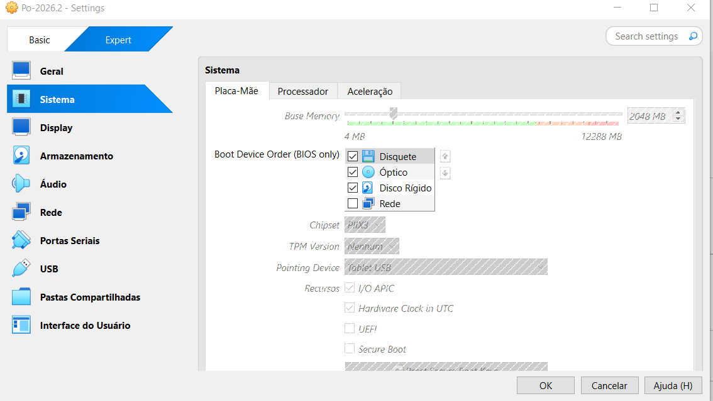
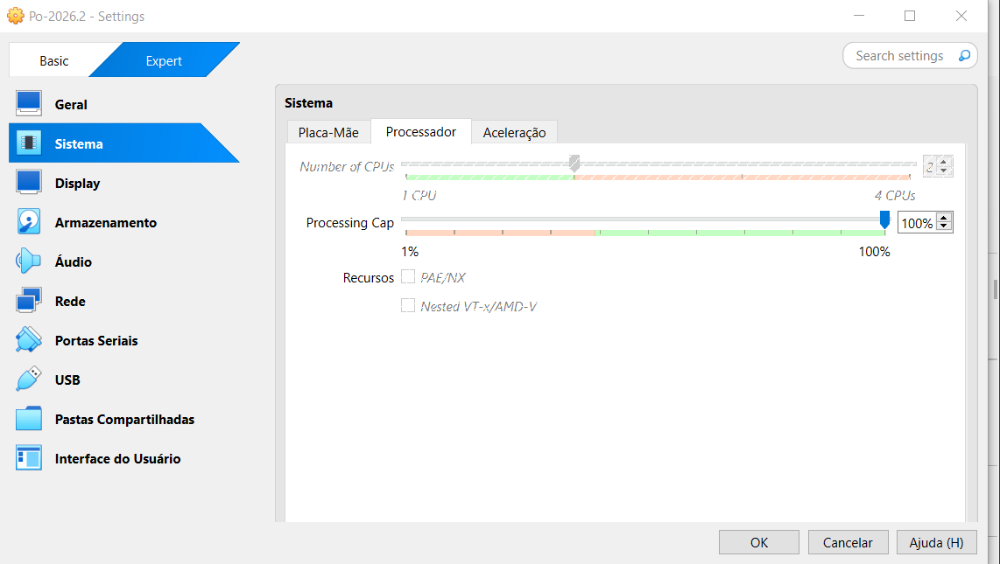
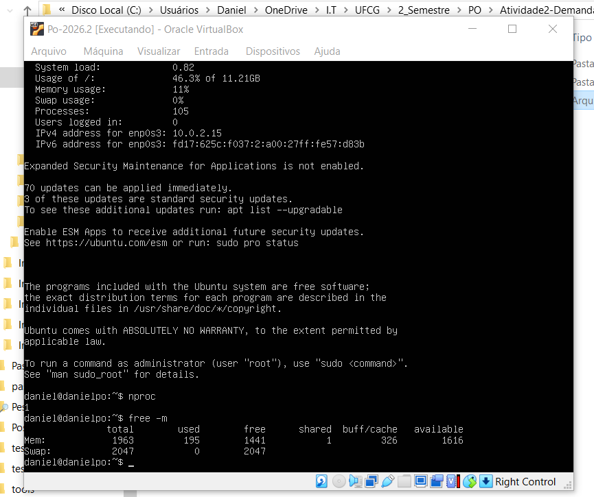
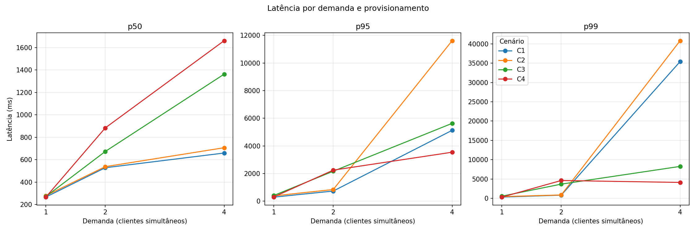
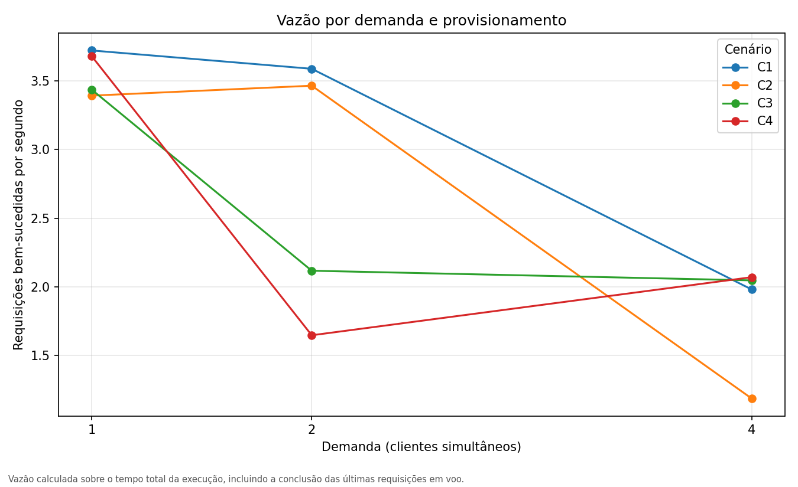
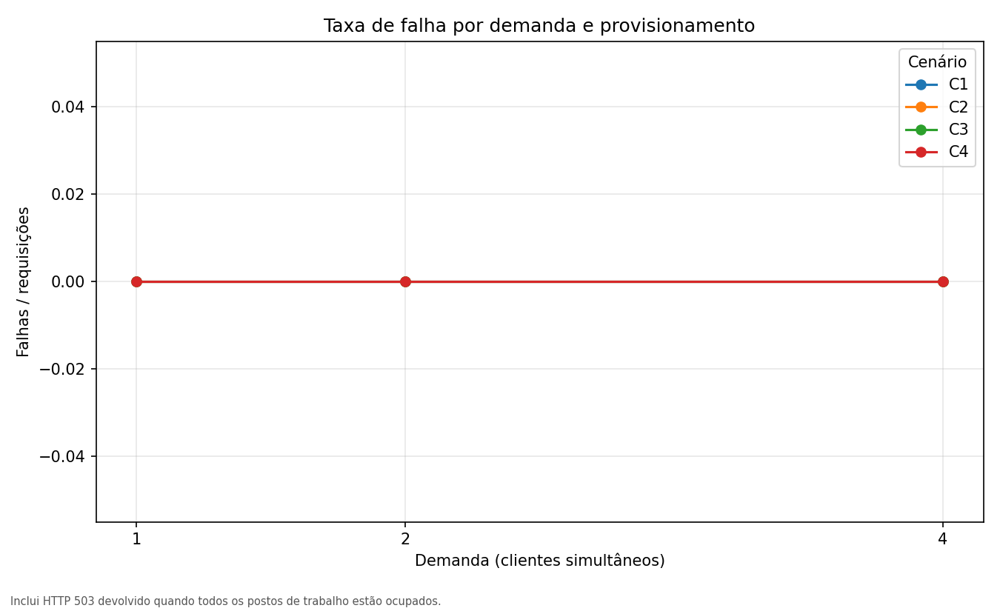
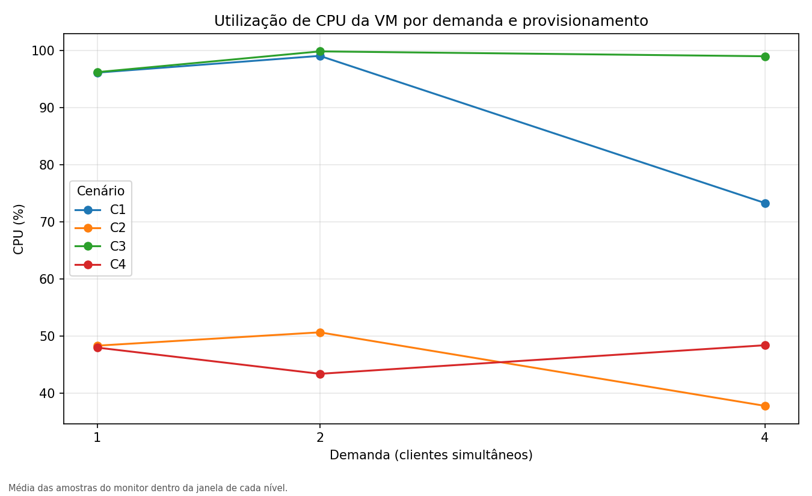
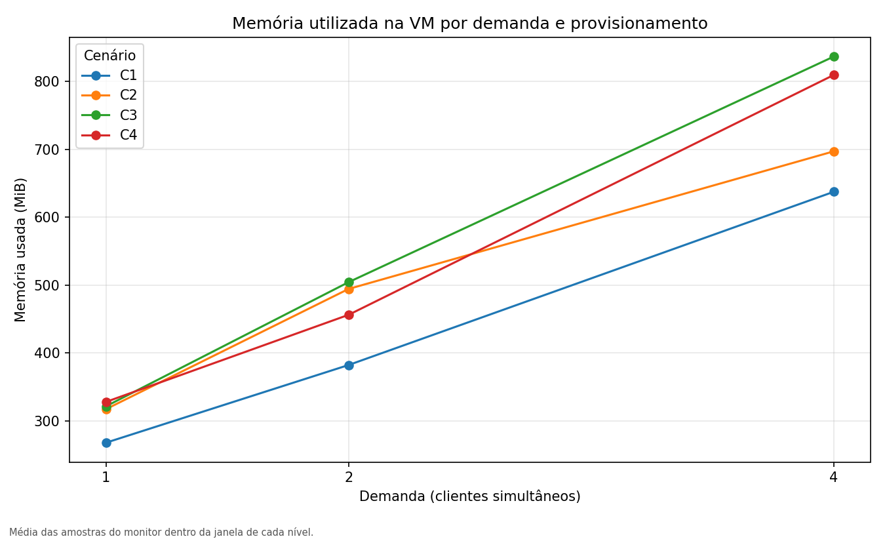
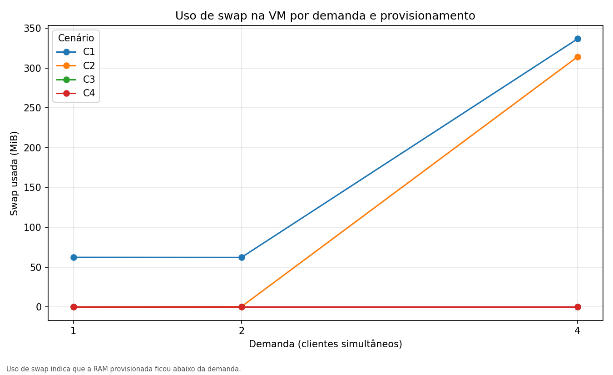

# Demanda, Provisionamento e Desempenho

**Grupo:** Daniel Anderson de Souza Silva · Ranya Duran Greco

| Nome | Matrícula |
| --- | --- |
| Daniel Anderson de Souza Silva | 0126015852-52M |
| Ranya Duran Greco | 0126015844-44M |


> **Conformidade com o template.** Este documento segue as seções do template
> disponibilizado pelo professor — *Aplicações desenvolvidas*; *Configuração da
> VM e Deploy da Aplicação*; *Teste de Stress da Aplicação Selecionada* — e
> cobre, dentro delas, os seis itens mínimos do enunciado: título e grupo (aqui),
> aplicações desenvolvidas (§1), configuração da VM e deploy (§2), teste de
> stress da aplicação selecionada (§3.1 e §3.2), resultados comparativos (§3.3) e
> interpretação e conclusões (§3.4).

---

## 1. Aplicações desenvolvidas

Desenvolvemos três aplicações web de backend em Python, uma para cada perfil
computacional pedido pelo enunciado. As três compartilham a mesma estrutura e o
mesmo contrato HTTP; o que muda entre elas é exclusivamente o trabalho que
executam. Isso é deliberado: mantendo o servidor, o contrato e a instrumentação
idênticos, qualquer diferença de desempenho observada entre elas pode ser
atribuída ao perfil de carga, e não a detalhes de implementação.

### 1.1 Estrutura

```
Atividade2-Demanda-Provisionamento-Desempenho/
├── README.md                          enunciado da atividade e decisões do grupo
├── RELATORIO.md                       este documento
├── figuras/                           figuras apresentadas neste documento
└── atividade2-demanda-desempenho/
    ├── evidencias/                    configuração da VM e capturas de tela
    └── atividade2/atividade2_demanda/
        ├── apps/
        │   ├── server.py              implementação única dos três perfis
        │   ├── cpu/server.py          lançador do perfil CPU-bound
        │   ├── memory/server.py       lançador do perfil Memory-bound
        │   └── io/server.py           lançador do perfil IO-bound
        ├── scripts/
        │   ├── load_test.py           gerador de carga (executa FORA da VM)
        │   ├── monitor.py             coleta de métricas da VM (executa NA VM)
        │   ├── run_scenario.py        orquestra um cenário completo
        │   ├── plot_results.py        gera os gráficos e a tabela consolidada
        │   └── capture_evidence.py    captura a configuração do VirtualBox
        ├── tests/
        │   └── test_applications.py   9 testes funcionais
        ├── requirements.txt
        └── results/                   dados brutos, summary.csv e graphs/
```

### 1.2 Contrato HTTP comum

| Rota | Resposta |
| --- | --- |
| `GET /health` | `{"status": "ok", "profile": "<perfil>"}` — identifica qual aplicação respondeu |
| `GET /work?size=N` | `{"profile": ..., "duration_seconds": ..., "result": {...}}` |
| Rota desconhecida | HTTP 404 |
| `size` inválido | HTTP 400 |
| Todos os slots ocupados | HTTP 503 |
| Falha de armazenamento (perfil IO) | HTTP 500 |

Todas as aplicações validam `size` antes de executar qualquer trabalho,
aceitando apenas um inteiro decimal positivo, e recusam valores acima do teto do
perfil. Esse teto existe para que um teste de carga não consiga levar a máquina a
consumo de recurso descontrolado.

### 1.3 As três aplicações

#### CPU-bound — `apps/cpu/server.py`

Executa SHA-256 repetidamente sobre um bloco fixo de 1 MiB, escrevendo o resumo
de volta nos primeiros 32 bytes do bloco, de modo que cada iteração dependa da
anterior e a requisição permaneça determinística. `size` é o número de iterações
(padrão 10, máximo 300). Resultado: `{"sha256": ..., "iterations": N}`.

O bloco ser grande é uma decisão de projeto, não um detalhe. O CPython libera a
GIL para entradas de `hashlib` com 2048 bytes ou mais. Uma cadeia de resumos
pequenos ficaria inteiramente dentro da GIL e a aplicação **não ganharia nada**
com vCPUs adicionais — exatamente a relação que o experimento precisa medir. Com
o bloco de 1 MiB, requisições concorrentes conseguem ocupar mais de um núcleo.

#### Memory-bound — `apps/memory/server.py`

Aloca `size` MiB, percorre o buffer escrevendo um byte a cada página de 4 KiB
(obrigando o sistema a materializar cada página em memória física) e devolve a
soma de uma amostra das páginas. `size` está em MiB (padrão 32, máximo 256).
Resultado: `{"allocated_mib": N, "checksum": ...}`.

O laço que percorre as páginas parece desperdício, mas é o que sustenta o
experimento. Ele devolve a GIL a cada ~5 ms, e é isso que permite que as
alocações de requisições concorrentes coexistam em memória ao mesmo tempo. Sem
esse laço — com o preenchimento feito em uma única chamada de C — o pico de
memória residente cai de 1033 MB para 265 MB e o cenário de 1 GB **deixa de
entrar em swap**. O detalhamento está na §3.4.4.

#### IO-bound — `apps/io/server.py`

Escreve `size` KiB em um arquivo temporário, força a descida para o disco com
`fsync`, e lê o arquivo de volta. `size` está em KiB (padrão 1024, máximo
32768). Resultado: `{"bytes_written": ..., "bytes_read": ...}`.

### 1.4 Execução

Cada aplicação é um processo independente:

```bash
python apps/cpu/server.py    --port 8000
python apps/memory/server.py --port 8000
python apps/io/server.py     --port 8000
```

Há também o ponto de entrada compartilhado, útil para testes:

```bash
python apps/server.py --profile memory --port 8000
```

Requisitos: Python 3.10 ou superior e `matplotlib` (apenas para os gráficos). O
servidor em si usa somente a biblioteca padrão. No interior da VM, o script de
monitoramento requer `python3-psutil`, instalado via `apt`.

### 1.5 Como a aplicação e a infraestrutura foram monitoradas

O monitoramento acontece em dois lugares, e essa separação é essencial ao
método:

- **Cliente (fora da VM)** — `scripts/load_test.py` mede a latência ponta a
  ponta que o cliente observa e a vazão efetiva. É dessa fonte que saem p50, p95,
  p99, vazão e contagem de falhas. Os percentis são calculados por interpolação
  linear sobre a amostra completa.
- **Servidor (dentro da VM)** — `scripts/monitor.py` amostra CPU, memória, swap e
  load average a cada ~0,5 s, usando `psutil`, e grava em `results/resources.csv`.

Medir a latência apenas dentro da aplicação omitiria o caminho cliente→servidor
e os efeitos da virtualização, que são justamente o objeto do estudo.

### 1.6 Testes

`tests/test_applications.py` contém 9 testes funcionais, cobrindo a identidade de
cada perfil, a forma do resultado de cada um, determinismo, tamanho padrão,
rejeição de tamanhos inválidos (`0`, `-1`, `1.5`, `not-a-number`, `1e3`,
`999999999`, vazio), HTTP 404, o ponto de entrada compartilhado, rejeição de
perfil desconhecido e o limite de admissão (HTTP 503).

```bash
python -m unittest discover -s tests -v
```

Nenhum teste verifica latência ou vazão: esses valores dependem da máquina e da
carga aplicada, portanto pertencem aos experimentos e ao relatório, nunca a um
critério de aprovação/reprovação.

---

## 2. Configuração da VM e Deploy da Aplicação

### 2.1 Ambiente hospedeiro

| Item | Valor |
| --- | --- |
| Máquina | Notebook pessoal, Windows 10 Home Single Language (10.0.19045) |
| Processador | Intel Core i3-6006U @ 2,00 GHz — **2 núcleos físicos**, 4 lógicos |
| Virtualização | Oracle VirtualBox |
| Geração de carga | No próprio hospedeiro, via `scripts/load_test.py` |

O número de núcleos físicos é relevante e está registrado de propósito: ele
limita a precisão alcançável nos níveis de demanda mais altos, porque o
hospedeiro executa ao mesmo tempo a VM, o gerador de carga e o motor de NAT do
VirtualBox. Voltamos a esse ponto na §3.4.5.

### 2.2 Máquina virtual

| Recurso | Valor |
| --- | --- |
| Nome | `Po-2026.2` |
| Sistema operacional | Ubuntu Server 22.04 LTS (64-bit) |
| Disco | 12 GB (VDI) |
| vCPUs | 1 ou 2, conforme o cenário (§3.1) |
| Memória | 1024 ou 2048 MB, conforme o cenário (§3.1) |
| Rede | NAT — endereço do guest `10.0.2.15` |
| Redirecionamento de portas | `ssh` 2222→22 e `app` 8080→8000 |
| Python | 3.10.12 |
| Monitoramento | `python3-psutil` 5.9.0 (via `apt`) |

### 2.3 A aplicação escolhida e suas características

O enunciado pede escolher **uma** das três aplicações para implantar na VM. A
escolhida foi a **Memory-bound**.

Suas características: recebe `size` em MiB, aloca um buffer desse tamanho,
percorre-o escrevendo um byte por página de 4 KiB — o que força o sistema
operacional a materializar cada página em memória física, em vez de deixá-la
como página zero preguiçosa — e devolve a soma de uma amostra das páginas como
verificação. O teto por requisição é de 256 MiB e o limite de admissão é de 4
requisições simultâneas, o que significa um pico teórico de 1 GiB de alocação
viva. É exatamente esse número que torna a aplicação sensível ao provisionamento
de memória da VM.

O motivo da escolha é metodológico. A matriz de cenários varia dois recursos:
vCPUs e memória. A aplicação Memory-bound é a única das três cujo comportamento é
diretamente controlado pelo provisionamento de memória — e o efeito é de ordem de
grandeza, não marginal: no cenário de 1 GB a VM troca páginas para o swap, no de
2 GB não troca nenhuma. As outras duas responderiam sobretudo a vCPUs, o que
produziria curvas muito mais próximas entre si.

### 2.4 Etapas para a configuração da máquina virtual

1. Instalação do Ubuntu Server 22.04 LTS no VirtualBox, seguindo o roteiro do
   professor (Figuras 1 a 3). A instalação foi feita com 2048 MB de memória: com
   1024 MB — o mínimo aceito pelo instalador — o processo travava.
2. Configuração da rede em modo NAT com dois redirecionamentos de porta,
   `ssh` 2222→22 e `app` 8080→8000, para que o hospedeiro alcance o guest.
3. Instalação do `python3-psutil` no guest via `apt` (o guest não possui `pip`, e
   não é necessário).
4. Cópia do código para `~/atividade2` no guest.
5. Execução dos testes dentro do guest: 9/9 aprovados.
6. Início da aplicação: `python3 apps/memory/server.py --port 8000`.
7. Verificação a partir do hospedeiro: `curl http://127.0.0.1:8080/health`
   devolve `{"status": "ok", "profile": "memory"}`, confirmando que o caminho
   hospedeiro→NAT→guest está funcionando.

### 2.5 Requisitos e etapas do deploy

| Requisito | Situação |
| --- | --- |
| Ubuntu Server 22.04 LTS | instalado na VM |
| Python 3.10+ | 3.10.12, já presente no sistema |
| `python3-psutil` | instalado via `apt` para o monitor |
| Rede do guest alcançável pelo hospedeiro | NAT + redirecionamento 8080→8000 |
| Código no guest | copiado para `~/atividade2` |

O deploy é direto porque a aplicação usa apenas a biblioteca padrão: não há
gerenciador de pacotes, build ou serviço a configurar. As etapas são a cópia do
código, a instalação do `psutil` e a execução do processo. Não há credenciais nem
segredos envolvidos na configuração.

### 2.6 Evidências da configuração

Cada cenário tem sua configuração registrada automaticamente pelo script
`scripts/capture_evidence.py`, que consulta o próprio VirtualBox e grava o
resultado. Optamos por capturar a configuração direto do VirtualBox, e não
redigitá-la, para que o registro não possa divergir do que de fato executou. As
capturas abaixo são as originais, copiadas para `figuras/`, ao lado deste
documento.



*Figura 1 — Configuração da placa-mãe no VirtualBox.*



*Figura 2 — Configuração do processador no VirtualBox.*



*Figura 3 — Ubuntu Server 22.04 LTS instalado e em execução.*

O registro completo de cada cenário está em `evidencias/`:

| Arquivo | Conteúdo |
| --- | --- |
| `C1-config.txt` … `C4-config.txt` | Resumo do provisionamento e a descrição completa da máquina (`VBoxManage showvminfo --machinereadable`), lidos da máquina em execução |
| `C1-console.png` … `C4-console.png` | Console do guest logo após o boot, na mesma sessão em que a medição foi feita |

---

## 3. Teste de Stress da Aplicação Selecionada

### 3.1 Cenários de configuração de recursos

Quatro cenários, cada um alterando **um único recurso** em relação ao anterior,
de modo que o efeito de cada variável seja isolável. O enunciado pede ao menos
quatro; o template menciona dois.

| Cenário | vCPUs | Memória | O que isola |
| --- | --- | --- | --- |
| **C1** | 1 | 1024 MB | Linha de base |
| **C2** | 2 | 1024 MB | Efeito de dobrar a CPU, mantendo a memória |
| **C3** | 1 | 2048 MB | Efeito de dobrar a memória, mantendo a CPU |
| **C4** | 2 | 2048 MB | Efeito de dobrar ambos |

### 3.2 Como foram realizados os testes de stress

**A carga é gerada fora da máquina virtual**, pelo hospedeiro, através do
redirecionamento de porta do NAT, usando `scripts/load_test.py` — um gerador
próprio, em Python, com um cliente por thread.

Escolhemos um gerador próprio em vez de uma ferramenta pronta (JMeter, `ab`,
`wrk`) por um motivo específico ao trabalho: precisávamos que cada requisição
fosse classificada individualmente por tipo de falha (timeout, conexão recusada,
HTTP 5xx) e que os percentis fossem calculados por interpolação linear sobre a
amostra completa, não estimados por histograma.

#### 3.2.1 Níveis de demanda

Três níveis por cenário: **1, 2 e 4 clientes concorrentes**.

O teto de 4 não é arbitrário. A aplicação Memory-bound tem um limite de admissão
de 4 requisições simultâneas (`DEFAULT_MAX_CONCURRENCY["memory"] = 4`), então o
nível 4 satura exatamente a capacidade configurada. Níveis acima disso apenas
exercitariam o caminho de rejeição por HTTP 503, que não é o que este
experimento quer medir.

#### 3.2.2 Tamanho da carga

Fixado em **256 MiB por requisição** (o máximo do perfil).

Esse valor foi escolhido por ser a única faixa em que o cenário de 1 GB e o de
2 GB se comportam de forma diferente. Com 4 clientes concorrentes, a carga
simultânea é de 4 × 256 MiB = 1024 MiB. Num guest de 1 GB, isso excede a memória
disponível e força o swap; num guest de 2 GB, cabe com folga. Tamanhos menores
não produziriam diferença alguma entre C1/C2 e C3/C4, e o experimento não teria
o que medir.

#### 3.2.3 Protocolo de medição

| Parâmetro | Valor |
| --- | --- |
| Aquecimento por nível | 5 s, não registrados |
| Medição por nível | 40 s |
| Timeout por requisição | 120 s |
| Repetições | 1 |
| Intervalo de amostragem da VM | ~0,5 s |
| Ordem | Níveis crescentes, dentro de um mesmo boot da VM |

O aquecimento existe para que o primeiro nível não seja penalizado por ser o
primeiro: ele aquece o cache de páginas do guest e leva o processo Python ao
regime estacionário.

#### 3.2.4 Coleta de dados

Três arquivos, todos preservados como dados brutos:

| Arquivo | Conteúdo | Origem |
| --- | --- | --- |
| `results/measurements.csv` | Uma linha por nível: latências (p50/p95/p99), vazão, tentativas, sucessos, erros por tipo | Hospedeiro |
| `results/run_log.csv` | Janela UTC de início e fim de cada nível | Hospedeiro |
| `results/resources.csv` | ~0,5 s: CPU, memória, swap, load average | Guest |

A atribuição das amostras de recurso ao nível de demanda correto é feita
cruzando-se as janelas UTC de `run_log.csv`. Sem isso, os gráficos de CPU e
memória por nível seriam médias de cenário inteiro e esconderiam justamente a
transição que interessa.

A partir desses três arquivos, `scripts/plot_results.py` gera a tabela
consolidada da §3.3.1 (`results/summary.csv`, uma linha por cenário e nível) e as
figuras da §3.3.3.

#### 3.2.5 Como reproduzir

```bash
# 1. Reconfigurar a VM para o cenário e iniciá-la
VBoxManage modifyvm "Po-2026.2" --cpus 1 --memory 1024
VBoxManage startvm  "Po-2026.2" --type headless

# 2. No guest: subir a aplicação e o monitor
python3 apps/memory/server.py --port 8000 &
python3 scripts/monitor.py --scenario C1 --seconds 185

# 3. No hospedeiro: varrer os níveis
python scripts/run_scenario.py --scenario C1 --size 256 \
    --levels 1,2,4 --duration 40 --warmup 5 --expect-profile memory

# 4. Gerar os gráficos
python scripts/plot_results.py
```

### 3.3 Resultados comparativos entre os cenários

#### 3.3.1 Tabela consolidada

Latência em milissegundos; vazão em requisições por segundo. A coluna de CPU é a
utilização **total da VM** (100% = todos os vCPUs provisionados ocupados), e por
isso não é comparável diretamente entre cenários de 1 e 2 vCPUs.

| Cenário | vCPU | RAM | Nível | Vazão | p50 | p95 | p99 | CPU | Memória | Swap |
| --- | --- | --- | --- | --- | --- | --- | --- | --- | --- | --- |
| C1 | 1 | 1024 | 1 | 3,72 | 266 | 293 | 341 | 96,1% | 268 MB | 62 MB |
| C1 | 1 | 1024 | 2 | 3,59 | 528 | 734 | 849 | 99,1% | 382 MB | 62 MB |
| C1 | 1 | 1024 | 4 | 1,98 | 659 | 5128 | 35405 | 73,3% | 638 MB | 337 MB |
| C2 | 2 | 1024 | 1 | 3,39 | 278 | 384 | 470 | 48,3% | 317 MB | 0 MB |
| C2 | 2 | 1024 | 2 | 3,47 | 537 | 844 | 891 | 50,6% | 494 MB | 0 MB |
| C2 | 2 | 1024 | 4 | 1,19 | 706 | 11616 | 40803 | 37,8% | 697 MB | 314 MB |
| C3 | 1 | 2048 | 1 | 3,44 | 270 | 411 | 579 | 96,2% | 322 MB | 0 MB |
| C3 | 1 | 2048 | 2 | 2,12 | 673 | 2171 | 3695 | 99,8% | 504 MB | 0 MB |
| C3 | 1 | 2048 | 4 | 2,05 | 1363 | 5633 | 8281 | 99,0% | 837 MB | 0 MB |
| C4 | 2 | 2048 | 1 | 3,68 | 265 | 308 | 331 | 48,0% | 328 MB | 0 MB |
| C4 | 2 | 2048 | 2 | 1,65 | 883 | 2247 | 4636 | 43,4% | 456 MB | 0 MB |
| C4 | 2 | 2048 | 4 | 2,07 | 1662 | 3545 | 4136 | 48,4% | 810 MB | 0 MB |

Em nenhum dos 12 níveis houve falha, erro ou timeout: 100% das requisições
respondidas com HTTP 200 (Figura 6).

#### 3.3.2 Picos por cenário

| Cenário | vCPUs | RAM | Pico de CPU | Pico de memória | **Pico de swap** |
| --- | --- | --- | --- | --- | --- |
| C1 | 1 | 1024 MB | 100% | 879 MB | **507 MB** |
| C2 | 2 | 1024 MB | 98% | 877 MB | **545 MB** |
| C3 | 1 | 2048 MB | 100% | 1202 MB | **0 MB** |
| C4 | 2 | 2048 MB | 53% | 1204 MB | **0 MB** |

#### 3.3.3 Gráficos

As figuras a seguir relacionam a demanda (número de clientes simultâneos) com o
desempenho observado e com a utilização dos recursos, em cada cenário. Elas são
geradas por `scripts/plot_results.py` em `results/graphs/` e copiadas para
`figuras/`, ao lado deste documento.



*Figura 4 — Latência por demanda e provisionamento: p50, p95 e p99 em painéis
separados, um por percentil.*



*Figura 5 — Vazão por demanda e provisionamento: requisições bem-sucedidas por
segundo.*



*Figura 6 — Taxa de falha por demanda e provisionamento: nula em todos os doze
pontos medidos.*



*Figura 7 — Utilização de CPU da VM por demanda e provisionamento. 100%
corresponde a todos os vCPUs provisionados ocupados, de modo que a altura não é
comparável entre cenários de 1 e de 2 vCPUs.*



*Figura 8 — Memória utilizada na VM por demanda e provisionamento.*



*Figura 9 — Uso de swap na VM por demanda e provisionamento — a evidência direta
do achado principal.*

#### 3.3.4 A assinatura de saturação

Em C1, a vazão sobe de 3,72 (nível 1) para 3,59 (nível 2) e **cai** para 1,98 no
nível 4, enquanto o p95 salta de 293 ms para 5128 ms — um fator de 17. Vazão que
para de crescer e depois regride, com a latência crescendo linearmente, é a
assinatura clássica de um recurso saturado (Figuras 4 e 5): os clientes
adicionais não produzem trabalho útil novo, apenas entram na fila. A Lei de
Little descreve exatamente isso — com vazão constante, o número de requisições em
voo cresce na proporção direta da latência.

### 3.4 Interpretação e conclusões

#### 3.4.1 O provisionamento de memória é o fator decisivo

O resultado mais limpo do experimento está na Figura 9 e na coluna de swap da
tabela §3.3.1. Os dois cenários com 1 GB entraram em swap sob carga — 507 MB em
C1 e 545 MB em C2. Os dois cenários com 2 GB registraram **zero** swap, em todos
os níveis.

Isso não é coincidência numérica: é a fronteira de memória sendo cruzada. Com 4
clientes de 256 MiB, a carga simultânea é de 1024 MiB. Somada ao consumo de base
do sistema (~230 MB), ela excede a memória utilizável de um guest de 1 GB — cujo
total já fica abaixo dos 1024 MB nominais por causa da reserva do hipervisor — e
cabe com folga nos 2 GB. Os picos medidos (Figura 8) confirmam a leitura: os dois
cenários de 1 GB chegaram a 879 MB e 877 MB de memória residente e ainda assim
precisaram recorrer ao swap, enquanto os de 2 GB chegaram a 1202 MB e 1204 MB sem
usá-lo.

O efeito sobre o desempenho é direto: no nível 4, o p95 de C4 (3545 ms) é
**3,3 vezes menor** que o de C2 (11616 ms), com a mesma CPU e o dobro de RAM. A
memória deixou de ser o gargalo.

#### 3.4.2 O provisionamento de CPU não ajuda esta aplicação

Dobrar os vCPUs não trouxe ganho em nenhum nível. Comparando os pares que
diferem só na CPU:

| Par | Vazão no nível 4 | Variação |
| --- | --- | --- |
| C1 (1 vCPU) → C2 (2 vCPU), ambos 1 GB | 1,98 → 1,19 rps | piorou |
| C3 (1 vCPU) → C4 (2 vCPU), ambos 2 GB | 2,05 → 2,07 rps | empatou |

A explicação está na coluna de CPU da tabela §3.3.1 e na Figura 7. Nos cenários
de 2 vCPUs a utilização total fica em torno de 48%, ou seja, **cerca de um
núcleo** — a VM nunca ocupa os dois. O recurso adicional simplesmente não é
utilizado.

A causa é a GIL do CPython. O trabalho da aplicação Memory-bound é Python puro,
e a GIL serializa a execução de bytecode: apenas uma thread executa por vez,
independentemente de quantos núcleos existam. Adicionar vCPUs a um workload
preso à GIL é adicionar capacidade que a aplicação não consegue usar.

Vale registrar que isso **não é um defeito da aplicação**. É uma propriedade da
combinação entre o perfil escolhido e a linguagem. A aplicação CPU-bound, por
exemplo, não sofre disso: ela usa `hashlib` sobre blocos de 1 MiB, e o CPython
libera a GIL nesse caso, permitindo paralelismo real. O contraste entre as duas
é, em si, um resultado interessante sobre desempenho em Python.

#### 3.4.3 O gargalo migra quando se adiciona memória

Em C3 (2 GB, sem swap), o nível 4 ainda degrada: a vazão fica em 2,05 rps e o p50
sobe de 270 ms para 1363 ms. Se não há swap, o que está saturando?

A CPU. Em C3 a utilização fica em 99,0% do único núcleo durante todo o nível 4, e
a memória utilizada nesse nível (837 MB em média) está bem abaixo dos 2048 MB
provisionados. O gargalo **migrou** de memória para CPU.

Esse é o ponto central da interpretação: adicionar um recurso não elimina a
degradação, apenas desloca o limitante. Uma análise que olhasse só a vazão
concluiria que "C3 é igual a C1"; olhando swap e CPU separadamente, vê-se que são
situações fisicamente diferentes.

#### 3.4.4 O laço de páginas é o que produz a pressão de memória

O laço que percorre as páginas (`for index in range(0, SIZE, 4096)`) parece
trabalho desperdiçado: o `bytearray(256 MiB)` já materializa todas as páginas
numa única operação de C. Para medir o que ele de fato faz, comparamos as duas
variantes no guest, com 4 requisições concorrentes de 256 MiB:

| Variante | Tempo por requisição | Pico de RSS do processo |
| --- | --- | --- |
| `bytearray()` + checksum, sem laço | 288 ms | **265 MB** |
| Implementação atual, com o laço | 298 ms | **1033 MB** |

O resultado é o oposto do que a aparência sugere:

1. **O laço custa 10 ms de 298 ms — cerca de 3%.** Quem domina o tempo é o
   próprio `bytearray(256 MiB)`, que já materializa todas as páginas numa única
   operação de C. Otimizar o laço não aceleraria praticamente nada.
2. **O laço é o que produz o swap.** Ele devolve a GIL a cada ~5 ms, e é
   justamente isso que permite que as quatro alocações coexistam — daí o pico de
   1033 MB. Sem o laço, a operação de C segura a GIL do início ao fim, as
   alocações não se sobrepõem, o pico cai para 265 MB e **o cenário de 1 GB
   deixaria de entrar em swap**. Removê-lo destruiria o achado principal, não o
   melhoraria.

O laço é, portanto, mantido de forma deliberada: ele não é um custo a eliminar, e
sim o mecanismo que dá ao perfil Memory-bound a sua característica distintiva.

#### 3.4.5 Limitações

Declaramos estas limitações explicitamente. Elas restringem a **precisão** dos
números, mas não sustentam nem derrubam as conclusões das §3.4.1 a §3.4.3.

**Contenção no hospedeiro.** O hospedeiro tem 2 núcleos físicos e executa
simultaneamente a VM, o gerador de carga e o motor de NAT do VirtualBox. Isso
produz ruído em todos os níveis. A evidência mais clara são duas anomalias sem
explicação física: C3 no nível 2 (2,12 rps) e C4 no nível 2 (1,65 rps) saíram
**piores** que C1 no nível 2 (3,59 rps), embora ambos tenham mais memória que C1.
Não há mecanismo que explique isso; é ruído de medição. Medições mais finas
exigiriam gerar a carga a partir de uma segunda máquina.

**Sem repetições.** Cada nível foi medido uma única vez. Não temos, portanto,
desvio padrão nem intervalo de confiança, e não é possível separar o efeito real
do ruído ponto a ponto. Como consequência, damos peso às **tendências** entre
cenários, não a diferenças isoladas entre níveis vizinhos.

**Amostras pequenas.** Cada requisição de 256 MiB custa cerca de 288 ms de
preenchimento serializado pela GIL (§3.4.4), o que fixa o teto em ~3,5 rps e
produz apenas 57 a 149 requisições por nível. O p50 é razoavelmente estável, mas
o p95 e principalmente o p99 repousam sobre poucas observações — o p99 de
35405 ms em C1 nível 4, por exemplo, corresponde a um único evento.

**Swap residual em C1.** O guest não foi reiniciado entre as sondas da §3.4.4 e a
medição de C1: a primeira amostra de recursos de C1, coletada ainda durante a
espera inicial e portanto antes de o nível 1 começar, já registrava 62,98 MB de
swap em uso. É esse valor que aparece nos níveis 1 e 2 de C1. O resíduo afeta a
linha de base absoluta de C1, mas não seu pico de 507 MB nem qualquer conclusão.

**HTTP 503 nunca observado.** O caminho de rejeição por limite de admissão existe
e é testado unitariamente, mas não foi exercitado sob carga. A serialização pela
GIL faz com que poucas requisições estejam em voo simultaneamente, então o limite
de 4 slots nunca é atingido. Torná-lo observável exigiria baixar o limite entre
cenários, o que alteraria a configuração da aplicação no meio da comparação.

**Uma aplicação.** O teste de stress cobre apenas a aplicação Memory-bound, como
o enunciado permite. As três aplicações são exercitadas localmente pela suíte de
testes descrita na §1.6, que sobe cada perfil e verifica o seu comportamento, mas
as conclusões quantitativas desta seção valem apenas para o perfil Memory-bound.

#### 3.4.6 Conclusões

1. **Provisionar memória resolveu o problema; provisionar CPU não.** Dobrar a RAM
   eliminou o swap (507/545 MB → 0 MB) e reduziu o p95 do nível mais exigente em
   3,3 vezes. Dobrar os vCPUs não produziu ganho mensurável, porque a aplicação
   está presa à GIL e não consegue ocupar mais de um núcleo.
2. **O gargalo se desloca, não desaparece.** Em 1 GB o limitante é a memória; em
   2 GB, com o swap eliminado, o limitante passa a ser a CPU, que satura em 99%
   de um núcleo. Provisionar corretamente exige saber qual recurso é o próximo
   limitante, e isso só aparece separando as métricas de aplicação das de
   infraestrutura.
3. **A vazão desta aplicação não responde à demanda.** Ela é limitada pela
   linguagem, não pelo hardware: ~3,5 rps em todos os cenários. O que a demanda
   adicional produz é latência — no nível 4 de C1, o p95 é 17 vezes o do nível 1.
   Um sistema com esse perfil deve ser escalado em processos, não em threads.
4. **A pressão de memória depende de um detalhe de implementação.** O laço de
   páginas em Python, que parece desperdício, é o mecanismo que faz as alocações
   concorrentes se sobreporem e, portanto, o que produz o swap. É ele que torna o
   perfil Memory-bound sensível ao provisionamento de RAM.
